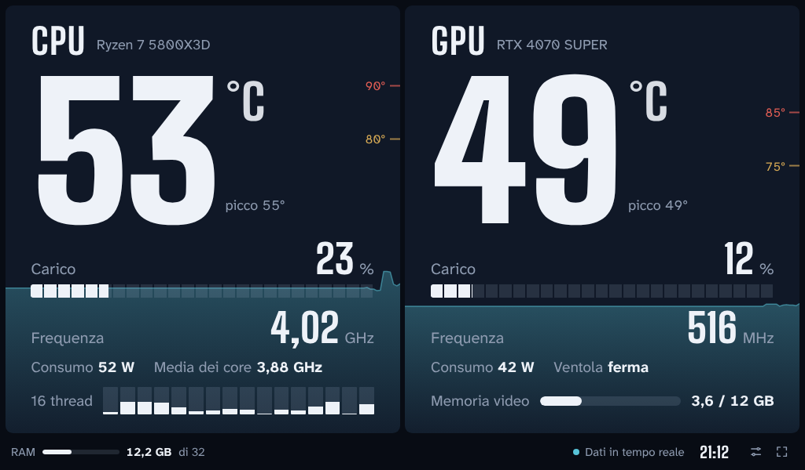
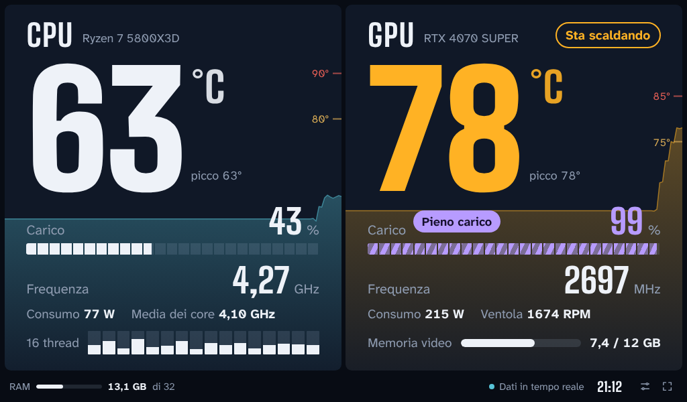
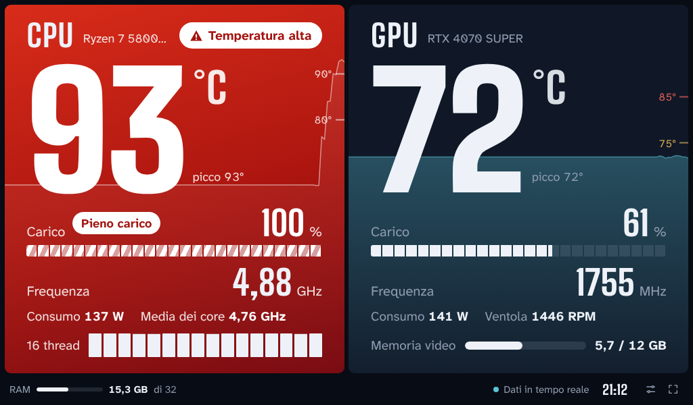
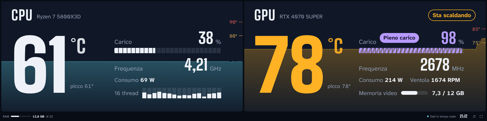

# Monitor PC

[English](README.md) | **Italiano**

[](https://github.com/cicciomerica90/monitor-pc/actions/workflows/tests.yml)

Temperature, frequenze e carico di CPU e GPU in tempo reale, pensato per restare aperto su un monitor piccolo accanto a quello principale. Gratuito, per Windows 10 e 11.



## Cosa mostra

- **CPU**: temperatura, carico totale, carico di ogni thread, frequenza più alta e media dei core, consumo.
- **GPU**: temperatura, carico, frequenza, consumo, ventola, memoria video.
- **RAM** usata e ora, nella striscia in basso.

Lo sfondo di ogni pannello è il grafico della temperatura degli ultimi due minuti, con le tacche delle soglie sul bordo destro.

## Come avvisa

| Stato | Cosa succede | Soglia iniziale |
|---|---|---|
| Sta scaldando | i numeri diventano ambra | CPU 80 °C, GPU 75 °C |
| Temperatura alta | il pannello diventa rosso e pulsa; avviso sonoro facoltativo | CPU 90 °C, GPU 85 °C |
| Pieno carico | barra viola a strisce con l'etichetta "Pieno carico" | carico sopra il 95% per qualche secondo |

Le soglie si cambiano dalle impostazioni (tasto `S`).




Si adatta a schermi orizzontali, verticali e a barra:



Le schermate usano dati dimostrativi.

## Installazione

1. Scarica il progetto: pulsante verde **Code** → **Download ZIP**, poi estrai la cartella.
2. Doppio clic su `Install.bat`.
3. Conferma la richiesta di amministratore di Windows.
4. Se compare la finestra "PawnIO is not installed", premi OK: è il driver che legge la temperatura della CPU.

Alla fine il monitor si apre da solo e sul desktop compare il collegamento **Monitor PC**. Trascina la finestra sul monitor piccolo e premi `F` per lo schermo intero.

Installatore e monitor parlano italiano su un Windows in italiano e inglese altrove. La lingua si cambia dalle impostazioni.

### Cosa fa l'installatore

- Copia il programma in `C:\Program Files\Monitor PC`.
- Scarica l'ultima versione di [LibreHardwareMonitor](https://github.com/LibreHardwareMonitor/LibreHardwareMonitor) da GitHub, gli attiva il server web locale (porta 8085) e lo imposta per partire ridotto a icona. Se sul PC ce n'è già uno in funzione, usa quello.
- Crea un'attività pianificata che avvia LibreHardwareMonitor a ogni accesso, senza richiesta di conferma.
- Crea il collegamento sul desktop e, se lo chiedi, quello per aprire il monitor a ogni accensione.
- Registra il programma tra le app installate, così si toglie da Impostazioni → App.

Per installare senza rete, metti `LibreHardwareMonitor.zip` (dalla pagina delle release di LibreHardwareMonitor) nella stessa cartella di `Install.bat`.

### Senza installatore

`Monitor PC.html` funziona anche da solo: avvia LibreHardwareMonitor, attiva **Options → Remote Web Server → Run** e apri il file in Edge o Chrome.

## Tasti

| Tasto | Azione |
|---|---|
| `F` | schermo intero |
| `S` | impostazioni: soglie, avviso sonoro, lingua, indirizzo di LibreHardwareMonitor |
| `D` | demo con dati finti |

## Disinstallazione

Impostazioni → App → App installate → Monitor PC, oppure doppio clic su `Uninstall.bat`. Il driver PawnIO resta installato e si toglie dallo stesso elenco.

## Come funziona

Windows non permette a una pagina web di leggere i sensori. Li legge LibreHardwareMonitor, che li pubblica su `http://localhost:8085/data.json`; `Monitor PC.html` li rilegge ogni secondo e li disegna. Tutto resta sul PC: la pagina non contatta nessun altro indirizzo.

Il programma è un unico file HTML, senza dipendenze. L'installatore è in PowerShell (`install.ps1`, `uninstall.ps1`) e si può leggere prima di eseguirlo.

## Limiti noti

- È una prima versione, provata finora su pochi PC. I nomi dei sensori cambiano da un hardware all'altro: se un valore resta "–", apri una segnalazione indicando CPU, GPU e versione di LibreHardwareMonitor.
- Lo schermo intero va rimesso con `F` a ogni avvio; la posizione della finestra invece viene ricordata.
- Interfaccia solo in italiano e inglese.

## Prove

A ogni modifica GitHub esegue tre gruppi di prove (il riquadro in alto ne mostra l'esito):

- **Pagina del monitor**: 42 prove in Chromium senza finestra, contro un LibreHardwareMonitor finto che ne imita i diversi formati di dati, le lingue e i guasti. La copertura del codice la misura Chromium stesso.
- **Installatore e disinstallatore**: prove Pester in Windows PowerShell 5.1 e PowerShell 7, con tutto ciò che modificherebbe il PC sostituito da finti. Scrivono solo in una cartella temporanea, quindi si possono eseguire anche sul proprio PC.
- **Installazione vera**: su un Windows pulito l'installatore viene eseguito davvero, poi la prova controlla file, attività pianificata, voce tra le app installate e che i sensori rispondano, infine disinstalla e controlla che non resti niente.

Per eseguirle in proprio:

```
pip install playwright && python -m playwright install chromium
python -m unittest discover -s tests/page -v

Install-Module Pester -MinimumVersion 5.5 -Scope CurrentUser
pwsh -File tests/powershell/Run-Tests.ps1
```

Risultati e rapporti di copertura finiscono in `tests/results/`.

## Crediti

Progettato e scritto da cicciomerica90 insieme a Claude, l'assistente di Anthropic.

## Licenze

Il codice di Monitor PC è distribuito con licenza MIT (vedi `LICENSE`).

Componenti di terze parti, dettagli in `THIRD-PARTY-NOTICES.txt`:

- [LibreHardwareMonitor](https://github.com/LibreHardwareMonitor/LibreHardwareMonitor), licenza MPL 2.0. Non è incluso: lo scarica l'installatore.
- Caratteri Big Shoulders e Atkinson Hyperlegible Next, licenza SIL OFL 1.1, incorporati in `Monitor PC.html`.
