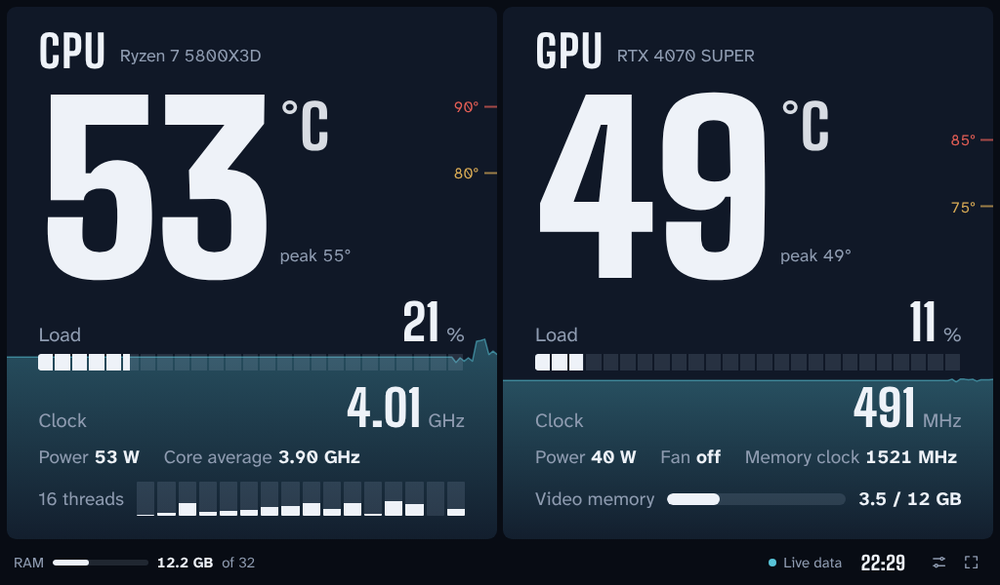
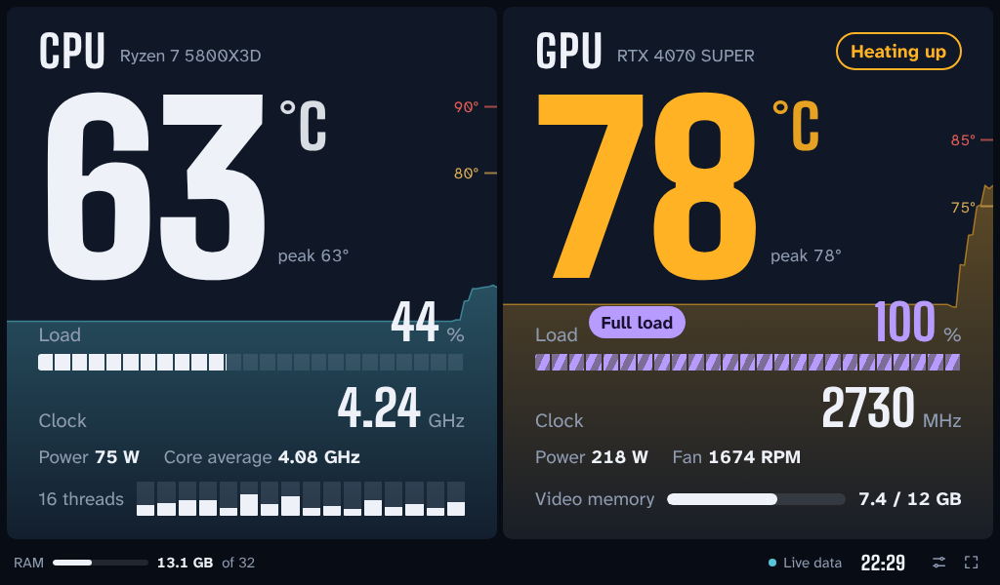
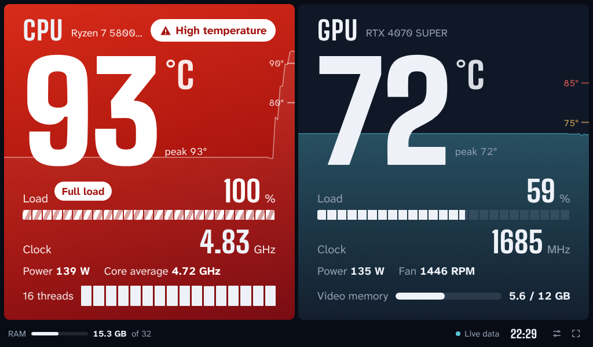
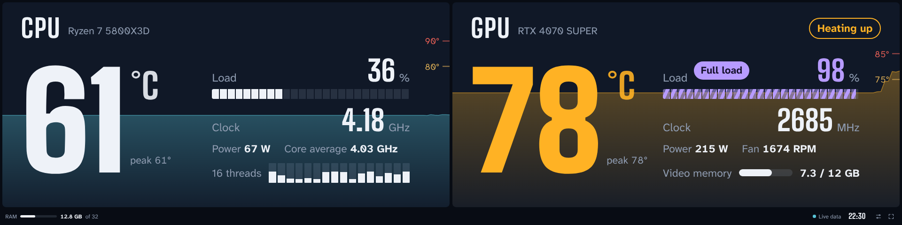

# Monitor PC

**English** | [Italiano](README.it.md)

Real-time CPU and GPU temperature, clock and load, made to stay open on a small secondary monitor. Free, for Windows 10 and 11.

## What it shows

- **CPU**: temperature, total load, load of each thread, highest clock and core average, power draw.
- **GPU**: temperature, load, clock, power draw, fan, video memory.
- **RAM** in use and the time, in the bottom strip.

The background of each panel is the temperature graph of the last two minutes, with the threshold marks on the right edge.

## How it warns you

| State | What happens | Default threshold |
|---|---|---|
| Heating up | the numbers turn amber | CPU 80 °C, GPU 75 °C |
| High temperature | the whole panel turns red and pulses; optional beep | CPU 90 °C, GPU 85 °C |
| Full load | purple striped bar with a "Full load" label | load above 95% for a few seconds |

Thresholds can be changed in the settings (`S` key).

It adapts to landscape, portrait and bar-shaped screens:

The screenshots use demo data.

## Install

1. Download the project: green **Code** button → **Download ZIP**, then extract the folder.
2. Double-click `Install.bat`.
3. Confirm the Windows administrator prompt.
4. If a window says "PawnIO is not installed", press OK: it is the driver that reads the CPU temperature.

When it finishes, the monitor opens by itself and a **Monitor PC** shortcut appears on the desktop. Drag the window to the small monitor and press `F` for full screen.

The installer and the monitor speak Italian on an Italian Windows and English everywhere else. You can switch language in the settings.

### What the installer does

- Copies the program to `C:\Program Files\Monitor PC`.
- Downloads the latest [LibreHardwareMonitor](https://github.com/LibreHardwareMonitor/LibreHardwareMonitor) from GitHub, turns on its local web server (port 8085) and sets it to start minimized to the tray. If one is already running on the PC, it uses that one.
- Creates a scheduled task that starts LibreHardwareMonitor at every logon, without a confirmation prompt.
- Creates the desktop shortcut and, if you ask for it, one that opens the monitor at every logon.
- Registers the program in the installed apps list, so it can be removed from Settings → Apps.

To install offline, put `LibreHardwareMonitor.zip` (from the LibreHardwareMonitor releases page) in the same folder as `Install.bat`.

### Without the installer

`Monitor PC.html` also works on its own: run LibreHardwareMonitor, turn on **Options → Remote Web Server → Run** and open the file in Edge or Chrome.

## Keys

| Key | Action |
|---|---|
| `F` | full screen |
| `S` | settings: thresholds, beep, language, LibreHardwareMonitor address |
| `D` | demo with fake data |

## Uninstall

Settings → Apps → Installed apps → Monitor PC, or double-click `Uninstall.bat`. The PawnIO driver stays installed and can be removed from the same list.

## How it works

Windows does not let a web page read hardware sensors. LibreHardwareMonitor reads them and publishes them at `http://localhost:8085/data.json`; `Monitor PC.html` reads that every second and draws it. Everything stays on the PC: the page contacts no other address.

The program is a single HTML file with no dependencies. The installer is plain PowerShell (`install.ps1`, `uninstall.ps1`), so you can read it before running it.

## Known limits

- This is an early version, tried on few machines so far. Sensor names change from one hardware to another: if a value stays "–", please open an issue with your CPU, GPU and LibreHardwareMonitor version.
- Full screen has to be turned on again with `F` at every start; the window position is remembered.
- Interface in English and Italian only.

## Credits

Designed and written by cicciomerica90 together with Claude, Anthropic's AI assistant.

## Licenses

Monitor PC's code is released under the MIT license (see `LICENSE`).

Third-party components, details in `THIRD-PARTY-NOTICES.txt`:

- [LibreHardwareMonitor](https://github.com/LibreHardwareMonitor/LibreHardwareMonitor), MPL 2.0 license. Not included: the installer downloads it.
- Big Shoulders and Atkinson Hyperlegible Next typefaces, SIL OFL 1.1 license, embedded in `Monitor PC.html`.
